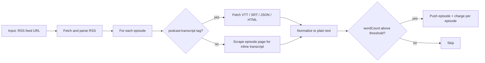

# Podcast Transcript to AI Dataset: RSS to Training Corpus

[](https://apify.com/Turboextract/podcast-transcript-dataset)
[](LICENSE)
[](#pricing)

**Feed in a podcast RSS feed. Get back every episode's publisher-hosted transcript as clean JSON for AI training, RAG, and content intelligence.** No Whisper, no audio processing, no $0.006/minute transcription bills.

Paste one RSS URL. Get a full-show transcript dataset. Pay only per episode with a usable transcript.

**Try it now →** [apify.com/Turboextract/podcast-transcript-dataset](https://apify.com/Turboextract/podcast-transcript-dataset)

> This repository holds documentation and ready-to-run API examples. The actor itself runs on the Apify platform - no installation needed.

---

## Why this exists

- **Transcribing audio is slow and expensive.** Many shows already publish transcripts; this actor collects them instead of re-running speech-to-text.
- **Transcripts hide in many formats.** Podcasting 2.0 `<podcast:transcript>` tags point to VTT, SRT, JSON or HTML files - all are parsed into plain text.
- **Episode pages are the fallback.** When a feed has no transcript tag, the episode's own web page is checked for a published transcript.
- **You only pay for usable text.** Episodes without a transcript, or under `minWordCount`, are skipped and never billed.

---

## Who this is for

- **AI / ML engineers** building voice, dialogue, or domain-expert corpora
- **RAG developers** indexing a podcast's full archive for a chatbot
- **Media analysts and researchers** tracking topic frequency across a show's run
- **Content teams** repurposing podcast content as search-indexable text
- **Dataset curators** assembling spoken-language training material cheaply

If you were about to pay $0.006/minute to transcribe a 500-episode archive, this costs 95% less when publishers already ship transcripts.

---

## What you get per episode

```json
{
  "podcastTitle": "The Lex Fridman Podcast",
  "podcastDescription": "Conversations about science, technology, history...",
  "language": "en-us",
  "episodeTitle": "Episode 400: Elon Musk",
  "episodeUrl": "https://lexfridman.com/elon-musk/",
  "guid": "ep-400",
  "publishedAt": "2026-10-15T14:00:00Z",
  "duration": "02:15:30",
  "audioUrl": "https://media.simplecast.com/ep-400.mp3",
  "transcriptSource": "https://lexfridman.com/transcripts/ep-400.vtt",
  "wordCount": 24180,
  "text": "Elon Musk: The most important thing I can say about...",
  "scrapedAt": "2026-11-08T12:00:00Z"
}
```

The output JSON shape is compatible with **AI Training Dataset Builder** and **Sitemap to AI Corpus** — chain the three freely for a mixed text + audio corpus.

Real output from a verified run: [examples/sample-output.json](examples/sample-output.json).

---

## How it works



**No audio transcription.** This actor only extracts transcripts the podcast publisher already hosts (via the Podcasting 2.0 `podcast:transcript` tag, or linked from the episode page). If you need Whisper-style audio-to-text, use a separate transcription service — this one stays cheap because it never touches audio.

---

## Quick start

### From the Apify Console (no code)

1. Click **Try for free**.
2. Paste one or more podcast RSS URLs.
3. (Optional) Set `publishedAfter` to limit to recent episodes.
4. Click **Start**.
5. Download as JSON, CSV, or Excel.

### From the API ([curl](examples/curl.sh))

```bash
curl -X POST "https://api.apify.com/v2/acts/Turboextract~podcast-transcript-dataset/runs?token=YOUR_TOKEN" \
  -H "Content-Type: application/json" \
  -d '{
    "rssUrls": ["https://podnews.net/rss"],
    "maxEpisodesPerFeed": 50,
    "publishedAfter": "2024-01-01",
    "minWordCount": 500
  }'
```

### From Python ([full example](examples/python.py))

```python
from apify_client import ApifyClient

client = ApifyClient("YOUR_TOKEN")
run = client.actor("Turboextract/podcast-transcript-dataset").call(run_input={
    "rssUrls": ["https://podnews.net/rss"],
    "maxEpisodesPerFeed": 100,
})
for ep in client.dataset(run["defaultDatasetId"]).iterate_items():
    print(ep["episodeTitle"], ep["wordCount"])
```

### From Node.js ([full example](examples/node.mjs))

```javascript
import { ApifyClient } from 'apify-client';

const client = new ApifyClient({ token: 'YOUR_TOKEN' });
const run = await client.actor('Turboextract/podcast-transcript-dataset').call({
    rssUrls: ['https://podnews.net/rss'],
    maxEpisodesPerFeed: 100,
    minWordCount: 200,
});
const { items } = await client.dataset(run.defaultDatasetId).listItems();
console.log(items);
```

---

## Input fields

| Field | Type | Default | Description |
|---|---|---|---|
| `rssUrls` | array | required | Podcast RSS feed URLs |
| `maxEpisodesPerFeed` | integer | 100 | Cap per feed |
| `publishedAfter` | string | — | ISO date; skip older episodes |
| `minWordCount` | integer | 200 | Skip thin transcripts |

---

## Pricing

**Pay per episode with a usable transcript. No subscriptions.**

| Volume | Price per episode | Total |
|---|---|---|
| Per episode | $0.003 | 1,000 episodes = $3 |
| 10,000 episodes | $0.003 | $30 |

Episodes without transcripts are silently skipped — you are not charged.

### How it compares

| Tool | Pricing model | 1,000 episodes |
|---|---|---|
| **Podcast Transcript to AI Dataset** | $0.003 per episode | **$3** |
| OpenAI Whisper API | $0.006 per audio minute | ~$360 (avg 60 min episodes) |
| AssemblyAI | $0.37 per audio hour | ~$370 |
| Deepgram | $0.26 per audio hour | ~$260 |
| Rev.com (human) | $1.50 per minute | $90,000 |

**Why so much cheaper?** This actor does not transcribe audio. It only harvests transcripts the publisher already ships via the Podcasting 2.0 standard or episode show-notes pages.

---

## Common use cases

- **AI training corpora** for conversational / interview / domain-expert models
- **RAG knowledge bases** over a podcast network's full back catalog
- **Topic modeling** across years of episodes to spot trend shifts
- **Searchable archives** for shows that only publish MP3s + bare show notes
- **Research corpora** on linguistics, interviewing technique, discourse analysis

---

## Tips for best results

- Podcasts on Podcasting 2.0 hosts (Transistor, Simplecast, Captivate, Fountain, Castopod) have the best transcript coverage
- Set `minWordCount: 500` to drop one-liners and ad-only episodes
- Use `publishedAfter` for incremental refreshes — pair with Apify's weekly scheduler
- If a podcast has no transcripts, you'll see 0 episodes processed and 0 charges — safe to try any feed

---

## Pairs well with

- **[AI Training Dataset Builder](https://apify.com/Turboextract/ai-training-dataset-builder)** — same JSON shape; combine article corpora with podcast corpora
- **[Sitemap to AI Corpus](https://apify.com/Turboextract/sitemap-to-ai-corpus)** — pair show-website pages with episode transcripts
- **[Research Citation Explorer](https://apify.com/Turboextract/research-citation-explorer)** — different buyer, same account

---

## FAQ

**What percentage of podcasts have transcripts?**
Growing fast. ~30% of top-100 shows now ship `podcast:transcript` tags; most major hosts (Simplecast, Transistor, Buzzsprout, Captivate, Fountain) add them automatically. Many indie shows publish full transcripts in show notes.

**Will this transcribe audio with Whisper?**
No. By design. Audio transcription is a different cost profile (~$0.006/min vs $0.003 per already-published episode). If you need that, use a dedicated transcription service and combine downstream.

**What formats are supported?**
WebVTT, SRT, JSON (Podcasting 2.0 segments), plain text, and HTML transcript pages. Format is auto-detected from MIME type.

**What about paywalled transcripts (Patreon, Substack private feeds)?**
This actor doesn't authenticate. Public RSS feeds only.

**Can I run on a schedule?**
Yes. Apify's scheduler + `publishedAfter` set to "last week" is perfect for incremental ingestion.

**What if an episode has multiple transcripts (multi-language)?**
We prefer JSON > VTT > SRT > HTML > plain text, in that order. Language-specific selection is on the roadmap.

**Does the output chain with other actors?**
Yes — `text`, `wordCount`, `publishedAt`, `language` fields match **AI Training Dataset Builder** exactly.

---

## SEO keywords

For visitors who arrived here from search: this tool is also referred to as a **podcast transcript scraper**, a **RSS to transcript converter**, a **podcast to text dataset**, a **podcast transcript API**, a **podcast:transcript tag parser**, a **VTT subtitle to text converter**, a **podcast training data for LLMs**, and a **Whisper alternative for published transcripts**.

---

## Support

- Open an issue on this repo for bug reports - please include your run input
- Actor page on Apify: [apify.com/Turboextract/podcast-transcript-dataset](https://apify.com/Turboextract/podcast-transcript-dataset)
- Community Discord: [discord.gg/8SrXSCpvgj](https://discord.gg/8SrXSCpvgj) - updates, support and feature requests
- Maintained by [Turboextract](https://apify.com/Turboextract) on the Apify platform

## License

[MIT](LICENSE) - examples and documentation. The actor itself is hosted on Apify under their platform terms.
